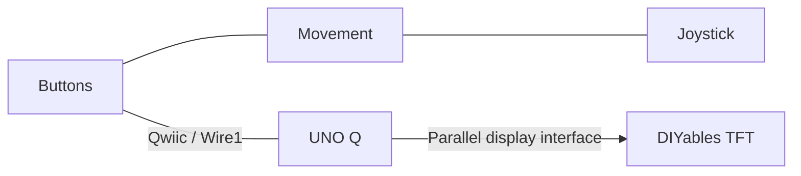
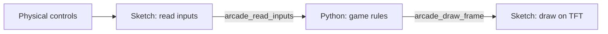
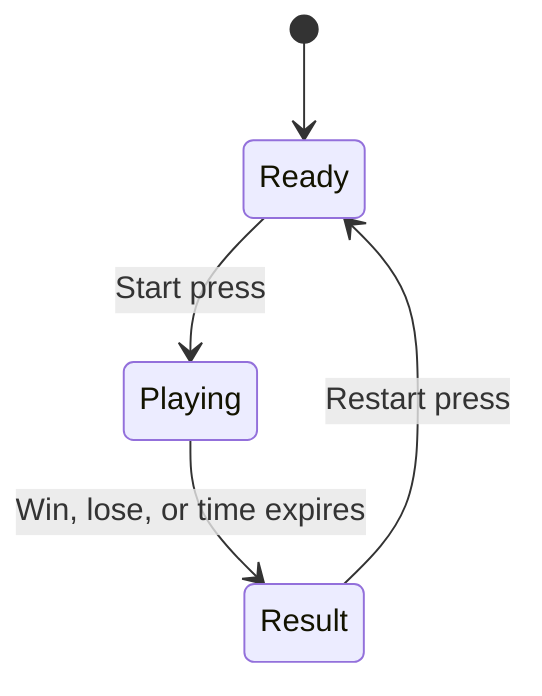

# Arcade: build a game for the UNO Q console

[All tracks](../README.md) · [Pre-work](PREWORK.md) · [Arduino references](PREWORK.md#arduino-references) · [Terminal commands](#terminal-commands) · [Hardware reference](#hardware-reference)

Build a game with a clear objective, physical controls, an ending, and a restart. The console arrives **preassembled** with an Arduino UNO Q, Modulino Joystick, Buttons and Movement, a printed body, and the DIYables 3.5-inch TFT.

Start with the included control preview, then choose **App Lab** for direct drawing or **RetroArch** for a software-rendered libretro game. Both use the supplied screen.

Before connecting your kit, complete the [pre-work](PREWORK.md) (about 30 minutes).

## 1. Connect to the console

You need [Arduino App Lab](https://docs.arduino.cc/software/app-lab/), a data-capable USB-C cable, and the console's supplied power arrangement.

1. Connect the UNO Q to your computer and follow the [App Lab board connection guide](https://docs.arduino.cc/software/app-lab/configure/config/).
2. Keep the prepared board software and assembled wiring in place. Make sure the joystick and buttons move freely.
3. Get the display-controller setting and prepared app ZIP supplied with your console.

The controls use the UNO Q's Qwiic connector (`Wire1`). The TFT uses the UNO headers.



## 2. Run the App Lab starter

For a terminal workflow, use [`make flash` and `make monitor`](#terminal-commands) below, then continue with the control preview here.

The App Lab application is the **`arcade/` folder**. The import ZIP is in [`zip/uno-q-arcade.zip`](zip/uno-q-arcade.zip), inside the visible `zip/` folder at the root of this track. To rebuild it after editing the source, open a terminal in `arcade/` and run this with GNU Make and `zip` installed:

```sh
make package
```

In App Lab's **My Apps**, import **`zip/uno-q-arcade.zip`** and select the UNO Q. Select the ZIP file itself; `zip/` only stores the archive. The archive contains `app.yaml`, `python/main.py`, and `sketch/` at the paths App Lab expects.

Without Make, rebuild the archive from `arcade/` in a macOS/Linux terminal:

```sh
mkdir -p zip
rm -f zip/uno-q-arcade.zip
zip -r zip/uno-q-arcade.zip app.yaml python sketch \
  -x '*/__pycache__/*' '*.pyc' '*/.DS_Store' '*/.venv/*' '*/build/*'
```

On Windows, ZIP `app.yaml`, `python/`, and `sketch/` with `app.yaml` at the archive root, and save it as `zip/uno-q-arcade.zip`.

In the imported `sketch/sketch.ino`, match `ARCADE_TFT_HX8357D` to the supplied console setting: **`1` for HX8357D** (the default), **`0` for RM68140**. Run the app. The first run needs Internet access and several minutes to download and compile dependencies.

The TFT shows a live control preview:

| Control | What you see |
| --- | --- |
| Joystick | A marker follows the stick and centers when released |
| A, B, C, and joystick press | The matching `0/1` state changes; Buttons LEDs follow presses |
| Movement | Acceleration changes from the neutral position, in milligravity (`1000 mg = 1 g`) |
| Connection status | `OK` for each available module |

Move the stick in all directions, press and release each button, then tilt the console and return it to its usual playing position. If a module shows `--`, have its connection checked with power off, then restart the app.

Edit the imported files in App Lab, then stop and run the app again. For a terminal-managed app, edit the local checkout and run `make flash` again. For an imported app, package and import local changes again. Export the app to preserve your code, controller selection, and calibration.

## 3. Adjust the controls

[`python/preview.py`](python/preview.py) contains the prepared defaults:

```python
DEAD_ZONE = 26
INVERT_X = False
INVERT_Y = True
MOVEMENT_ZERO_MG = (50, -75, 1034)
MOVEMENT_DEAD_ZONE_MG = 20
```

Set `INVERT_X` or `INVERT_Y` to match the mounted joystick. Adjust `DEAD_ZONE` only enough to keep its resting marker centered.

Movement should read near zero in the calibrated playing position. Tilt the console and return it to that position. A different mounting or playing position needs a new [Movement baseline](#calibrate-movement). These values describe acceleration changes, not angles in degrees.

Keep these settings in sync between the imported App Lab app and the board's RetroArch checkout.

### Calibrate Movement

Place the console in its usual playing position and keep it still. The preview subtracts a baseline from each acceleration axis and applies a dead zone. This centers game input; it does not calculate tilt angles.

Temporarily insert this code before `App.run(...)` in `python/main.py`. Its existing imports provide `Bridge`, `json`, and `time`:

```python
samples = []
for _ in range(100):
    sample = json.loads(Bridge.call("arcade_read_inputs"))
    assert sample["connected"] & 4, "Connect Movement and restart the app"
    samples.append([sample[key] for key in ("ax", "ay", "az")])
    time.sleep(0.05)
axes = list(zip(*samples))
assert all(max(axis) - min(axis) <= 40 for axis in axes), "Keep still and retry"
print("MOVEMENT_ZERO_MG =", tuple(round(sum(axis) / len(axis)) for axis in axes))
```

Copy the printed tuple to `MOVEMENT_ZERO_MG` in `python/preview.py`, remove the sampling code, and restart the app. Begin with `MOVEMENT_DEAD_ZONE_MG = 20`. The preview should settle near zero, change when tilted, and return near zero in the original position. Recalibrate if the module mounting or playing position changes.

Raw `arcade_read_inputs` acceleration still includes gravity. Keep the calibrated `preview.py` in both the exported App Lab app and the RetroArch checkout. RetroArch uses its joystick settings; tilt needs a separate game-specific mapping.

## 4. Choose your game workflow

### App Lab: draw directly on the TFT

The included [`python/main.py`](python/main.py) reads the controls, applies calibration, and asks the sketch to draw the preview. Its core calls are:

```python
inputs = json.loads(Bridge.call("arcade_read_inputs"))
frame = frame_values(inputs)
Bridge.call("arcade_draw_frame", *frame)
```

These lines belong inside the starter's existing `loop()`, which supplies the imports, error handling, and RetroArch display-ownership check. Keep that structure as you add game rules.



Use `python/main.py` for game state and [`sketch/sketch.ino`](sketch/sketch.ino)'s `drawFrame()` for graphics. When adding a drawing argument, update the Python call and the sketch function together. Send compact game state through Bridge and draw only the areas that change.

The input snapshot provides:

| Field | Meaning |
| --- | --- |
| `connected` | Bits `1=Buttons`, `2=Joystick`, `4=Movement` |
| `buttons` | Bits `1=A`, `2=B`, `4=C`, `8=joystick press` |
| `x`, `y` | Raw joystick axes, `-127` to `128` |
| `ax`, `ay`, `az` | Raw acceleration in mg, including gravity |
| `video` | Nonzero while a RetroArch stream owns the display |

`frame_values(inputs)` returns calibrated marker coordinates, button bits, Movement deltas, and connection bits in the order expected by `arcade_draw_frame`. Use connection bits before acting on a control. Keep the input bounds and the sketch's 1.5-second display timeout when extending the starter.

A sketch-only game can reuse the same control and drawing routines, with its game rules in C++.

### RetroArch: run a libretro game

Follow the [RetroArch guide](retroarch/README.md) to open its menu and launch a software-rendered core on the TFT. You supply the core, game, and assets; none are bundled.

The bridge suits slow or mostly static games. A full-screen update takes seconds over this connection. Choose App Lab's direct drawing for games that depend on fast reactions. The launcher maps the joystick and buttons; Movement, touch, and audio are not mapped.

## 5. Build one complete round

For a first App Lab game, turn the marker into a target game:

1. Draw a fixed target and a short instruction on the TFT.
2. Move the marker with the joystick.
3. On a **new A press**, score when the marker is inside the target.
4. Show the result and accept a **new C press** to restart.

Put the round state and button-press edges in Python. Extend `drawFrame()` and its matching Bridge call to show the target, prompt, and result. Keep the first target fixed until the whole round works, then add your own rules or variation.



Track the previous button state so holding a button does not repeatedly start or restart. Use elapsed time for movement and timers. Keep positions within the visible area, pause if a required control is unavailable, and reset score, positions, and time for each new round.

Keep instructions and outcomes on the console screen. Use readable text, simple shapes, and a clear control map before adding artwork or animation. Touch is optional and needs [separate calibration](#optional-touch-input).

## 6. Make it easy to play again

Give the console to someone who has not used your game. They should be able to understand the objective, finish a round, and restart from the on-screen instructions. Use their playthrough to tune control sensitivity, text size, and difficulty.

Save the source, launch command, control map, controller setting, calibration, and asset credits. The [arcade rubric](../README.md#arcade-rubric) describes the complete result.

## Code map

| File | Role |
| --- | --- |
| [`python/main.py`](python/main.py) | Preview loop; add your game state here |
| [`python/preview.py`](python/preview.py) | Input bounds and shared control calibration |
| [`sketch/sketch.ino`](sketch/sketch.ino) | Modulino input, Bridge methods, and TFT drawing |
| [`sketch/sketch.yaml`](sketch/sketch.yaml) | Pinned UNO Q core and Arduino libraries |
| [`sketch/video_protocol.h`](sketch/video_protocol.h) | Small image tiles used by RetroArch |
| [`retroarch/`](retroarch/README.md) | Linux launcher and control mapping |

The controls and enclosure are based on the [Arduino UNO Q Arcade Bundle](https://projecthub.arduino.cc/Arduino_Genuino/uno-q-arcade-bundle-b272c5), with the [DIYables TFT shield](https://diyables.io/products/3.5-320x480-tft-lcd-color-touch-screen-shield-for-arduino-uno-mega) added as the console display.

## Terminal commands

After the board's initial setup, you can develop from a **macOS/Linux terminal** in `arcade/`. Install GNU Make, `zip`, and [Android SDK Platform-Tools](https://developer.android.com/tools/releases/platform-tools), with `adb` on your command path. The prepared UNO Q provides Python 3 and [Arduino App CLI](https://github.com/arduino/arduino-app-cli), which builds and runs both parts of the app.

```sh
make devices
make flash
make monitor
```

`make flash` copies this track's `app.yaml`, `python/`, and `sketch/` to `~/ArduinoApps/uno-q-arcade-cli` on the board, compiles and uploads the MCU sketch, and starts Python. The first run needs Internet access to download dependencies. Match the display controller and control calibration in your local source before flashing.

After editing local files, run `make flash` again. It replaces those source paths, including edits made to that copy in App Lab, while preserving the app's `data/`, `.env`, and dependency cache. Save game data under `data/`, outside the replaced source folders. Other App Lab projects are left in place.

| Command | Action |
| --- | --- |
| `make` | List available commands |
| `make devices` | List connected ADB devices |
| `make flash` | Deploy this track, upload its sketch, and start Python |
| `make monitor` | Open the MCU serial monitor |
| `make logs` | Follow Python output, including `print()` and errors |
| `make stop` | Stop this track's terminal-managed app |
| `make package` | Rebuild [`zip/uno-q-arcade.zip`](zip/uno-q-arcade.zip) for App Lab import |
| `make build` | Compile only the MCU sketch locally with [Arduino CLI](https://arduino.github.io/arduino-cli/) |
| `make clean` | Remove this track's local ZIP and sketch build |

Use **Ctrl+C** to leave the monitor or logs; the app keeps running. Use `make stop` when finished. For Python game logic, keep `make logs` open in a second terminal.

With one USB device connected, no board selection is needed. If several are connected, use the serial from `make devices` on each board command:

```sh
make flash SERIAL=YOUR_UNO_Q_SERIAL
make monitor SERIAL=YOUR_UNO_Q_SERIAL
make logs SERIAL=YOUR_UNO_Q_SERIAL
make stop SERIAL=YOUR_UNO_Q_SERIAL
```

Only one App Lab app can run at a time. If another app is running, stop it in App Lab or use a board terminal before flashing:

```sh
adb -d shell
TMPDIR=/tmp arduino-app-cli app list
TMPDIR=/tmp arduino-app-cli app stop APP_ID
exit
```

Replace `APP_ID` with its ID from the list. With multiple devices, replace `adb -d shell` with `adb -s YOUR_UNO_Q_SERIAL shell`. Tool paths can be overridden with `ADB=...` or `ARDUINO_CLI=...`; local Arduino CLI is needed only for `make build`.

## Hardware reference

The console is supplied preassembled. Use this section when preparing or maintaining a unit; normal development starts with the software steps above.

### Display and wiring

The [DIYables 3.5-inch TFT shield](https://diyables.io/products/3.5-320x480-tft-lcd-color-touch-screen-shield-for-arduino-uno-mega) uses an 8-bit parallel display interface and resistive touch. The starter uses landscape **480×320** and defaults to **HX8357D**. Set `ARCADE_TFT_HX8357D` to `0` for an RM68140 unit. Older ILI9488 units need a different driver.

The vendor lists UNO/Mega support; UNO Q requires attention to its own electrical limits. With power disconnected, compare the shield signals and supply arrangement with the [UNO Q manual](https://docs.arduino.cc/tutorials/uno-q/user-manual/) and [pinout](https://docs.arduino.cc/resources/pinouts/ABX00162-full-pinout.pdf). UNO Q GPIO uses 3.3 V logic, and **A0 and A1 are not 5 V tolerant**. Resolve signal-level differences before powering the assembly.

| Pins | Shield function |
| --- | --- |
| D2–D9 | Display data; D6/D7 are also used by touch |
| A0 | Display read |
| A1 | Display write / touch Y+ |
| A2 | Display command-data / touch X− |
| A3 | Display chip select |
| A4 | Display reset |
| D10–D13 | Optional microSD interface |

Connect the Modulinos through **Qwiic / `Wire1`**, leaving the TFT pins dedicated to the shield. The starter uses Buttons at `0x3E`, Joystick at `0x2C`, and Movement at `0x6A`. Leave microSD unused for the starter.

### Board software

Use the MCU runtime matching the pinned Zephyr **0.55.2** core. Follow Arduino's [Zephyr migration instructions](https://support.arduino.cc/hc/en-us/articles/27251870677916-Migrating-to-Zephyr-core-0-55-0-on-UNO-Q) when preparing an older board. Keep the full dependency list in [`sketch.yaml`](sketch/sketch.yaml).

Run the [Arcade starter](#2-run-the-app-lab-starter) with the fitted display controller selected. The title, control states, and marker should fit the screen. For display-only setup, the [DIYables library](https://github.com/DIYables/DIYables_TFT_Touch_Shield) includes `DrawShapes` and `ShowTextAndNumber` examples for each supported controller.

Supply the console with its controller setting, calibrated app, board connection details, and power arrangement. For RetroArch, also prepare the [Linux launcher](retroarch/README.md), core, content, and launch command.

### Optional touch input

The starter uses Modulinos for gameplay. To add touch, run the vendor's `TouchCalibration` example for the fitted controller and rotation, then use `TouchGetPoint` or `TouchButton`. Save the calibration, try the center and corners, and confirm release and drag behavior. Display and touch share pins, so preserve the library's pin-mode switching and analog-read assumptions.
